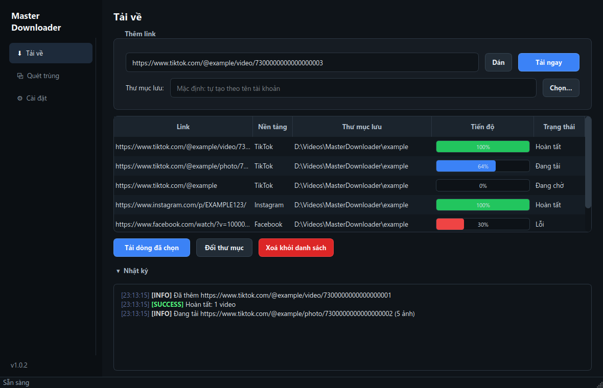
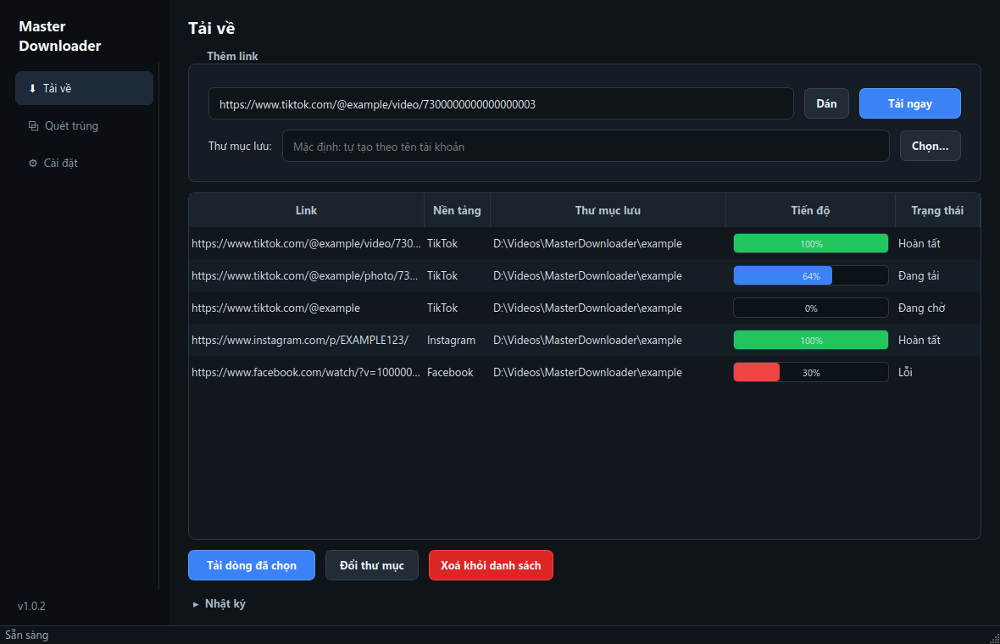
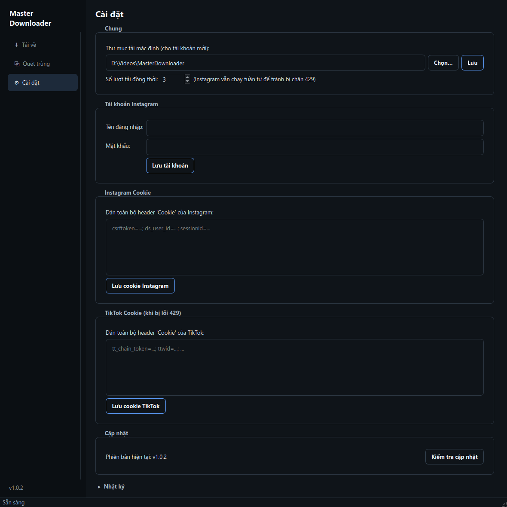
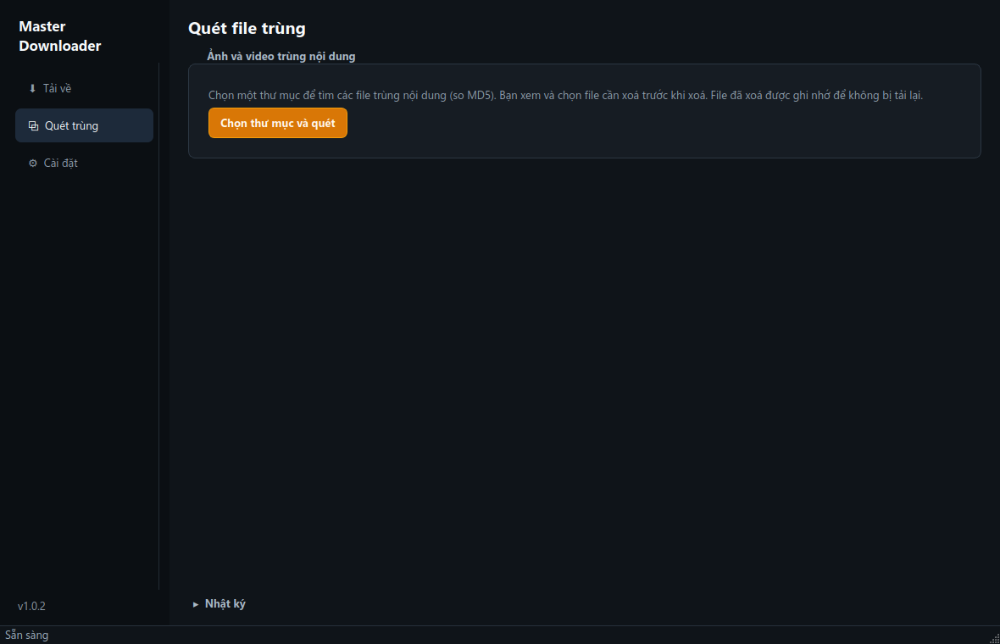
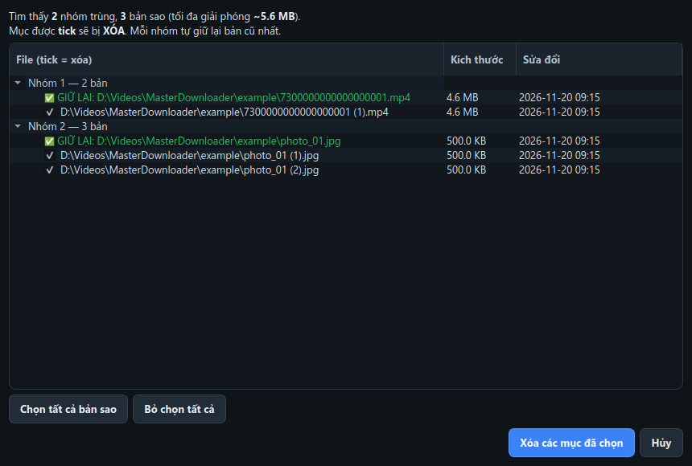

# MasterDownloader

[](https://github.com/thientrile/MasterDownloader-releases/releases/latest)
[](https://github.com/thientrile/MasterDownloader-releases/releases)
[](LICENSE)

App Windows tải video, bài ảnh và story từ TikTok, Instagram, Facebook. Dán link (một video hay cả trang cá nhân), app tự xếp file vào thư mục theo tên tài khoản, nhớ những gì đã tải để không tải lại, và có công cụ quét xoá file trùng. Miễn phí, mã nguồn mở (GPL-3.0), tự cập nhật.

*English below.*



## Tính năng

| Nền tảng / công cụ | Tải được |
|---|---|
| TikTok | Video, bài ảnh (`/photo/`), story lẻ, toàn bộ story của trang cá nhân (`/@user/stories`), mọi video của trang cá nhân (`/@user`) |
| Instagram | Bài viết, reel, story, highlight (cần cookie hoặc tài khoản) |
| Facebook | Video và reel công khai |
| Quét trùng | Tìm ảnh/video trùng nội dung (MD5) trong một thư mục, xem trước rồi mới xoá |
| Khác | Tải nhiều link cùng lúc (chỉnh được số lượt), bỏ qua file đã tải, kéo thả link, tự cập nhật |

> Tuỳ chọn chỉ tải âm thanh (MP3) đang ở [PR #5](https://github.com/thientrile/MasterDownloader-releases/pull/5), chưa có trong bản phát hành.

## Cài đặt

Tải từ trang [Releases](https://github.com/thientrile/MasterDownloader-releases/releases/latest):

| File | Dùng khi |
|---|---|
| **`MasterDownloader-Setup.exe`** (khuyên dùng) | Cài cho người dùng hiện tại, không cần quyền admin. Có shortcut Start Menu (tuỳ chọn Desktop), gỡ trong **Settings → Apps**. |
| `MasterDownloader.exe` | Bản portable: chạy trực tiếp, không cần cài (vd. chạy từ USB). |

**Cảnh báo SmartScreen:** exe chưa ký số nên ở lần chạy đầu Windows sẽ hiện "Windows protected your PC". Bấm **More info → Run anyway**.

**Kiểm tra file tải về (tuỳ chọn):** mở PowerShell trong thư mục chứa file rồi chạy

```powershell
Get-FileHash .\MasterDownloader-Setup.exe -Algorithm SHA256
```

So kết quả với dòng tương ứng trong `SHA256SUMS.txt` ở cùng Release. Khác nhau thì đừng chạy file đó.

## Hướng dẫn sử dụng

### 1. Tải từ TikTok



1. Copy link trên TikTok (nút **Chia sẻ → Sao chép liên kết**, hoặc thanh địa chỉ trình duyệt).
2. Bấm **Dán** (hoặc kéo thả link vào cửa sổ) rồi bấm **Tải ngay**.
3. Link được thêm vào bảng; cột **Tiến độ** và **Trạng thái** cho biết đang tải tới đâu. Bấm **▸ Nhật ký** để xem chi tiết.

Link app nhận:

| Muốn tải | Dạng link |
|---|---|
| Một video | `https://www.tiktok.com/@user/video/123…` hoặc link rút gọn `vt.tiktok.com/…` |
| Một bài ảnh | `https://www.tiktok.com/@user/photo/123…` |
| Một story | Link chia sẻ story, hoặc `https://www.tiktok.com/@user/story/123…` |
| Mọi story của trang | `https://www.tiktok.com/@user/stories` |
| Mọi video của trang | `https://www.tiktok.com/@user` |

Với link trang cá nhân, lần tải sau chỉ lấy bài mới vì app nhớ những gì đã tải. Muốn đổi nơi lưu cho một dòng thì chọn dòng đó rồi bấm **Đổi thư mục**; app nhớ thư mục theo tên tài khoản cho những lần sau.

### 2. Instagram và Facebook: cookie

Instagram chỉ cho tải khi đã đăng nhập, nên app cần **cookie** (hoặc tên đăng nhập/mật khẩu) trong **Cài đặt**. TikTok chỉ cần cookie khi bị chặn (lỗi 429). Facebook tự thử dùng cookie của trình duyệt Edge; video công khai thường không cần gì thêm.



Cách lấy cookie an toàn (Chrome/Edge):

1. Mở `https://www.instagram.com` (hoặc `tiktok.com`) và đăng nhập.
2. Nhấn **F12** → tab **Network** → nhấn **F5** để tải lại trang.
3. Bấm vào dòng đầu tiên (`www.instagram.com`) → mục **Request Headers** → copy toàn bộ giá trị sau `cookie:`.
4. Dán vào ô **Instagram Cookie** (hoặc **TikTok Cookie**) trong **Cài đặt** rồi bấm **Lưu**.

Lưu ý: cookie cho phép đăng nhập vào tài khoản của bạn, nên đối xử với nó như mật khẩu.
- Không gửi cookie cho ai và không dán vào web/app nào khác. App chỉ lưu nó trên máy bạn (`%APPDATA%\MasterDownloader`, mã hoá bằng khoá tạo riêng trên máy), nhưng ai đọc được thư mục đó vẫn dùng được.
- Nên dùng tài khoản phụ: tải nhiều có thể khiến nền tảng hạn chế tài khoản.
- Nghi lộ cookie thì **đăng xuất** tài khoản trên trình duyệt; cookie cũ sẽ hết hiệu lực.

### 3. Quét file trùng



Bấm **Chọn thư mục và quét**. App so nội dung (MD5) và hiện các nhóm trùng; mỗi nhóm tự giữ bản cũ nhất, các bản còn lại được tick sẵn. Xem lại, bỏ tick những file muốn giữ, rồi bấm **Xóa các mục đã chọn**. File đã xoá được ghi nhớ để lần sau không bị tải lại.



## File tải về và dữ liệu nằm ở đâu

- **File tải về:** thư mục **Thư mục lưu** trên trang Tải về. Để trống thì app dùng **Thư mục tải mặc định** trong Cài đặt (mặc định là thư mục Downloads) và tạo thư mục con theo tên tài khoản.
- **Dữ liệu của app:** `%APPDATA%\MasterDownloader` (gõ đường dẫn này vào thanh địa chỉ của File Explorer). Thư mục này chứa cài đặt, danh sách đã tải, cookie và tài khoản đã mã hoá cùng `secret.key`. Gỡ cài đặt không xoá thư mục này; muốn xoá sạch thì xoá nó bằng tay. Bản cũ lưu dữ liệu cạnh file exe; dữ liệu đó được chuyển sang đây tự động ở lần chạy đầu.

## Cập nhật tự động

Khi mở, app kiểm tra bản mới trên GitHub tối đa một lần mỗi ngày; bạn cũng có thể bấm **Cài đặt → Kiểm tra cập nhật**. Có bản mới thì app hỏi trước (Cập nhật ngay / Để sau / Bỏ qua bản này) và không cập nhật khi đang có lượt tải. File mới được kiểm SHA256 theo `SHA256SUMS.txt` rồi app tự khởi động lại: bản cài chạy bộ cài mới ở chế độ im lặng, bản portable thay file exe tại chỗ.

Khi yt-dlp hoặc gallery-dl (thư viện tải bên trong) có bản mới, một bản vá được build, test và phát hành tự động mỗi tuần, nên cứ để app tự cập nhật là đủ.

## Câu hỏi thường gặp / khắc phục lỗi

**TikTok báo lỗi 403.** App tự thử lại các bài bị 403 trong một tiến trình mới. Vẫn lỗi thì đợi vài phút rồi bấm **Tải dòng đã chọn**, cập nhật app lên bản mới nhất, và nếu cần thì dán cookie TikTok.

**TikTok báo 429 (Too Many Requests).** TikTok đang giới hạn bạn. Giảm **Số lượt tải đồng thời** trong Cài đặt, đợi một lúc, và dán cookie TikTok.

**Instagram báo cần đăng nhập, 401, hoặc trước tải được mà giờ không.** Cookie đã hết hạn hoặc bị đăng xuất. Lấy cookie mới theo hướng dẫn ở trên, dán đè rồi bấm **Lưu cookie Instagram**.

**Video tải về không có tiếng.** App ghép hình và tiếng bằng ffmpeg đóng gói sẵn. Hãy cập nhật lên bản mới nhất và xem **Nhật ký** để tìm lỗi ffmpeg. Chạy từ source thì cần cài đủ `requirements.txt` (gồm `imageio-ffmpeg`).

**Không thấy file đã tải.** Xem cột **Thư mục lưu** của dòng đó, hoặc bấm chuột phải vào dòng → **Mở thư mục**.

**Windows chặn không cho chạy.** Xem phần cảnh báo SmartScreen ở mục Cài đặt.

Lỗi khác: mở [Issue](https://github.com/thientrile/MasterDownloader-releases/issues) kèm link (nếu công khai) và đoạn **Nhật ký**. Xoá cookie, tên tài khoản và đường dẫn cá nhân trước khi gửi.

## Điều khoản và miễn trừ trách nhiệm

- **Mục đích:** công cụ tải nội dung cho mục đích cá nhân. Chỉ tải nội dung bạn có quyền tải (của chính bạn, được chủ sở hữu cho phép, hoặc pháp luật cho phép). Bạn tự chịu trách nhiệm tuân thủ luật bản quyền và Điều khoản dịch vụ của từng nền tảng.
- **Không liên kết:** không liên kết, không được bảo trợ bởi TikTok, ByteDance, Meta (Facebook, Instagram), Google (YouTube) hay nền tảng nào khác. Tên và nhãn hiệu thuộc về chủ sở hữu tương ứng.
- **Không bảo hành:** phần mềm được cung cấp "NGUYÊN TRẠNG" (AS IS), không có bất kỳ bảo đảm nào. Tác giả không chịu trách nhiệm về thiệt hại phát sinh từ việc sử dụng phần mềm, trong phạm vi tối đa pháp luật cho phép.
- **Dữ liệu:** không thu thập dữ liệu. Tài khoản và cookie chỉ lưu trên máy bạn (`%APPDATA%\MasterDownloader`). App chỉ kết nối tới nền tảng bạn tải và tới GitHub để kiểm tra cập nhật.
- **Chưa ký số:** Windows SmartScreen sẽ cảnh báo ở lần chạy đầu (bấm **More info → Run anyway**). Kiểm tính toàn vẹn bằng `Get-FileHash <file> -Algorithm SHA256` rồi so với `SHA256SUMS.txt`.
- **Giấy phép: GPL-3.0** (toàn văn trong `LICENSE`). Mã nguồn: [thientrile/MasterDownloader-releases](https://github.com/thientrile/MasterDownloader-releases). Thành phần bên thứ ba theo giấy phép riêng của chúng: `THIRD_PARTY_LICENSES.txt`. Lưu ý pháp lý đầy đủ: `DISCLAIMER.txt`.
- **Liên hệ, gỡ nội dung, khiếu nại:** mở [Issue ở repo releases](https://github.com/thientrile/MasterDownloader-releases/issues).

**English:** Personal-use download tool. Download only content you have the right to; you are responsible for complying with copyright law and each platform's Terms of Service. Not affiliated with or endorsed by TikTok, ByteDance, Meta, Google/YouTube or any other platform; trademarks belong to their owners. Provided "AS IS" without warranty; no liability to the extent permitted by law. No data collection: credentials and cookies stay on your computer. Unsigned executable: expect a SmartScreen warning; verify with `SHA256SUMS.txt`. License: GPL-3.0 (`LICENSE`), source code at https://github.com/thientrile/MasterDownloader-releases; third-party licenses in `THIRD_PARTY_LICENSES.txt`; full notice in `DISCLAIMER.txt`. Contact/takedown: open an issue in the releases repo.

## English

MasterDownloader is a free, open-source (GPL-3.0) Windows app that downloads videos, photo posts and stories from TikTok, Instagram and Facebook. It sorts files into one folder per account, skips what it has already downloaded, finds and removes duplicate files, and updates itself.

- **Install:** download `MasterDownloader-Setup.exe` (per-user installer, no admin rights needed) or the portable `MasterDownloader.exe` from [Releases](https://github.com/thientrile/MasterDownloader-releases/releases/latest). The exe is unsigned, so SmartScreen warns on first run: click **More info → Run anyway**. Verify with `Get-FileHash <file> -Algorithm SHA256` against `SHA256SUMS.txt`.
- **Use:** paste a link (TikTok video, photo post, story, `/@user/stories`, or `/@user` profile; Instagram post/reel/story/highlight; Facebook video) and click **Tải ngay** (Download). The UI is in Vietnamese; the screenshots above follow the steps.
- **Cookies:** Instagram needs a cookie or login under **Cài đặt** (Settings). Copy the `cookie` request header from your browser's DevTools (F12 → Network) while logged in. Treat it like a password: never share it, prefer a secondary account, and log out in the browser to invalidate a leaked cookie. TikTok only needs a cookie when rate-limited (429).
- **Files and data:** downloads go to the chosen folder (default: your Downloads folder, one subfolder per account). App data, including settings, download history, and encrypted cookies and credentials, lives in `%APPDATA%\MasterDownloader` and is kept on uninstall.
- **Updates:** the app checks GitHub once a day, asks before installing, verifies SHA256 and restarts. Patch releases ship automatically when yt-dlp or gallery-dl update.
- **Troubleshooting:** for TikTok 403, the app retries automatically; if that fails, wait, update, or add a TikTok cookie. For 429, lower concurrent downloads and add a cookie. For Instagram login errors, the cookie has expired, so paste a fresh one. For a video without sound, update and check the log (ffmpeg is bundled). Otherwise open an issue with the log, after removing cookies and personal paths.
- MP3 (audio only) is pending in [PR #5](https://github.com/thientrile/MasterDownloader-releases/pull/5).

## Chạy từ source / Run from source

```bash
./StartApp.sh        # Linux/WSL, tự tạo .venv
StartApp.bat         # Windows
```

Test: `QT_QPA_PLATFORM=offscreen python -m unittest discover -s tests`

Ảnh trong README / README screenshots (dữ liệu giả, chạy từ bản sao mã nguồn trong thư mục tạm): `QT_QPA_PLATFORM=offscreen python tools/screenshots.py`

## Build và phát hành / Build and release

- `build.bat` build `dist\MasterDownloader.exe` (PyInstaller onefile), giống CI.
- Mỗi push/PR: GitHub Actions chạy test, build exe và bộ cài trên Windows, rồi smoke test cả hai (artifact `MasterDownloader-windows`).
- Push tag `vX.Y.Z` tạo GitHub Release gồm exe, Setup, `SHA256SUMS.txt`, `versions.txt` và các file giấy phép:

```bash
git tag v1.0.2 && git push origin v1.0.2
```

- `auto-patch.yml` chạy hằng tuần: yt-dlp/gallery-dl có bản mới thì build lại Release mới nhất với hai thư viện đó, test rồi phát hành `vX.Y.Z+1`.
